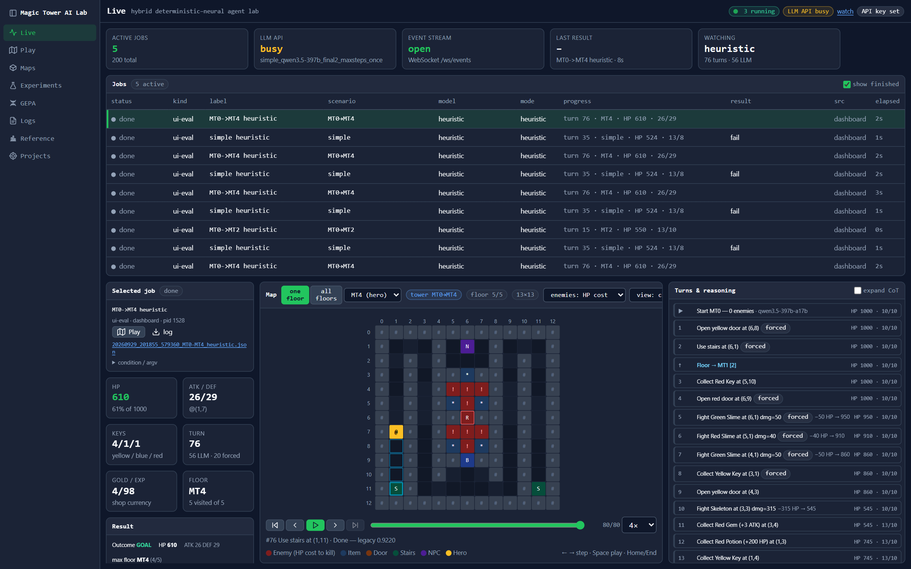
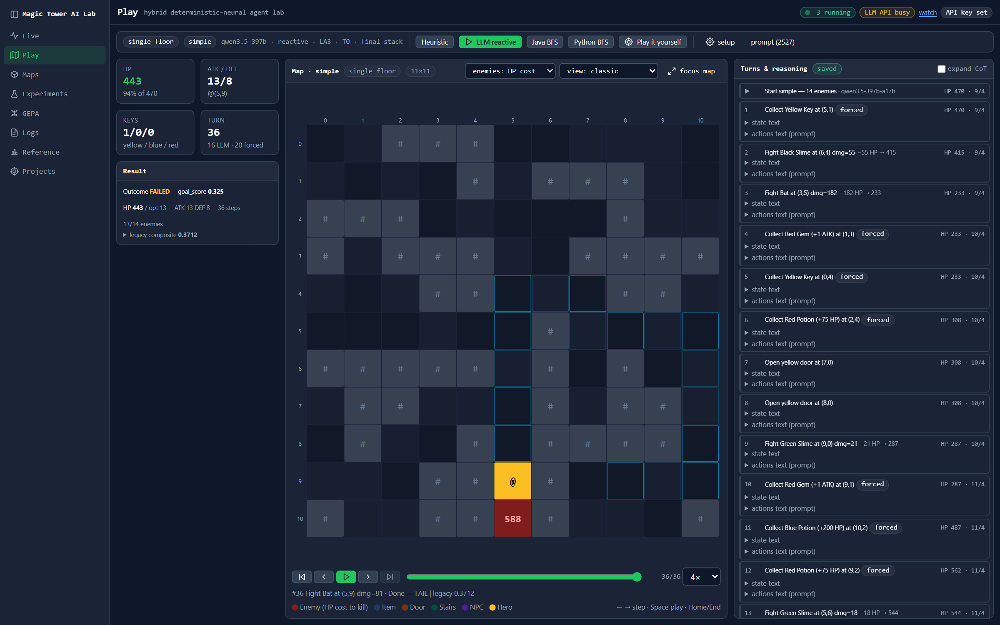
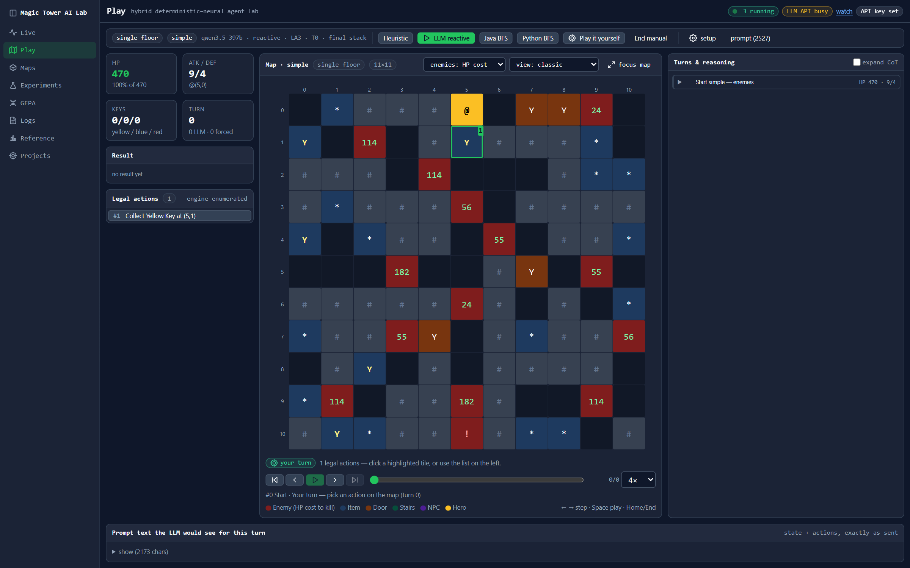
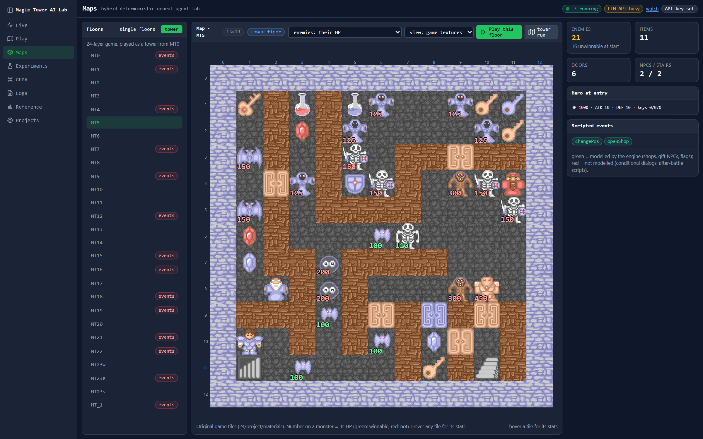
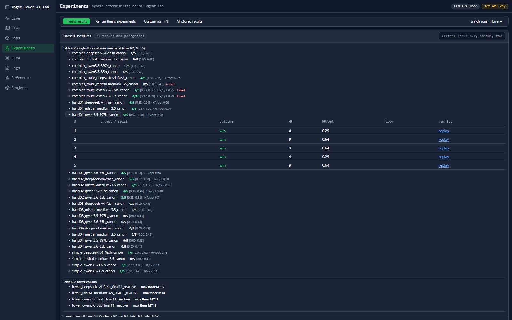
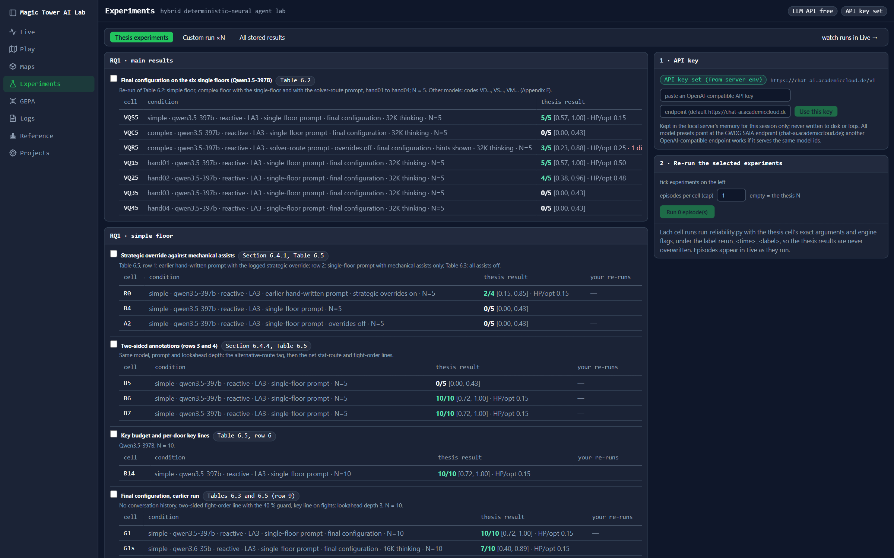
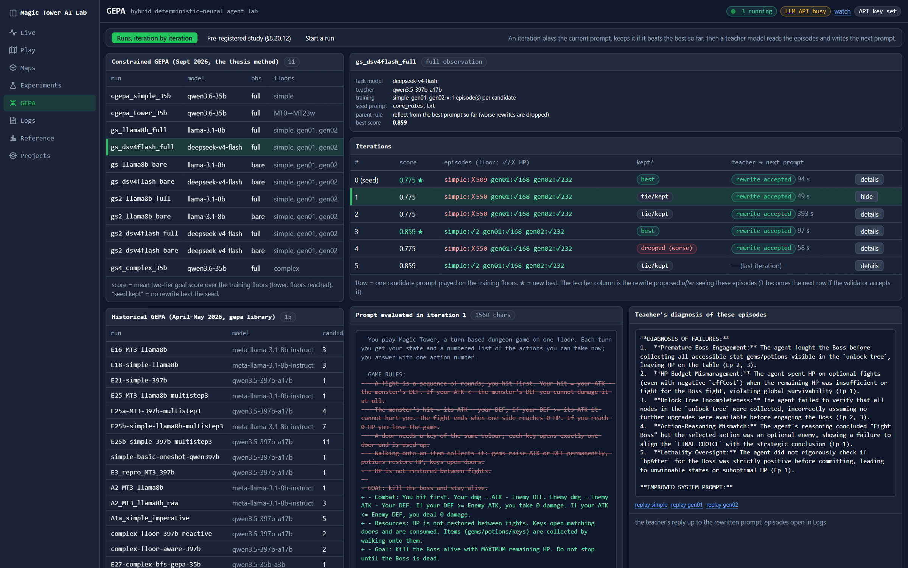
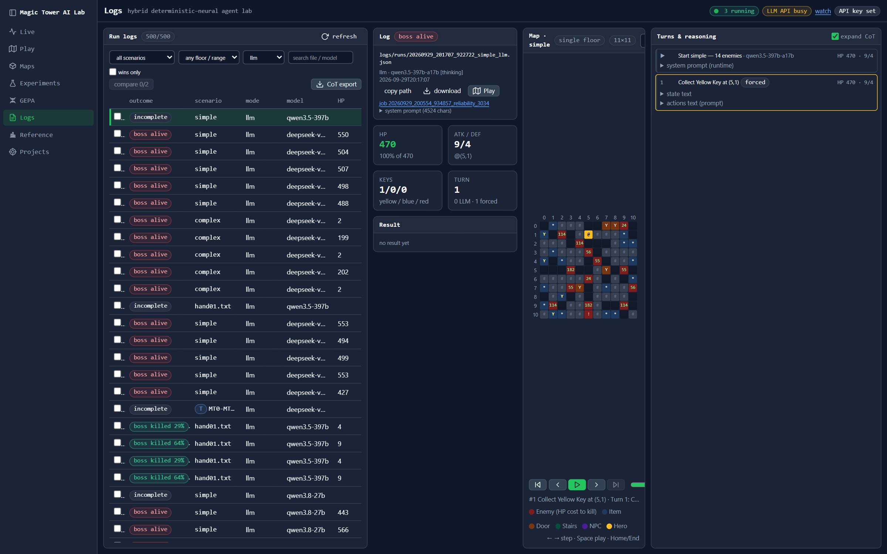

# Platform guide

The *Magic Tower AI Lab* is a FastAPI server with a statically exported Next.js front end.
Start it with `python -m mota.dashboard` after building the front end
([getting started](getting-started.md#3-build-and-start-the-platform)). Every run, from the browser or
from the command line, uses the same harness and appears live.

The top bar shows the running jobs and holds the API key panel (the key is kept in server memory only).
For a guided tour with screenshots and a video, see the [walkthrough](walkthrough.md).

## Live

All running and finished jobs with label, floor, model, progress and result. Selecting a job mirrors
its map, attributes and turn cards from its run log while it runs, including tower runs of several hours
started from a terminal. Jobs can be paused, resumed and stopped between turns.
`/play/?job=<id>` follows a job full-size.

## Play

One episode on the map: run settings and playback on the left, the map in the centre, one card per
turn on the right with the exact text sent to the model, its reasoning and answer, the executed action
and any override with the model's original choice. From here you can

- run the heuristic or a model on any floor or tower range with any condition (model, prompt, lookahead,
  planning mode, engine settings);
- edit the system prompt and keep versions;
- play yourself in **manual mode**: every legal action is ringed and numbered on the map, click a tile to
  take it;
- replay any stored run log (`/play/?log=<file>`) and the solver's route (Java BFS replay).

## Maps

Every single floor and every tower floor with its exact-solver facts (optimum, winning sets, states)
and, for the tower, the scripted events of the floor marked by whether the engine models them. Maps can
be drawn as coloured cells with the engine's numbers or with the original game's tiles.

## Experiments

| Tab | What it shows |
|---|---|
| **Thesis results** (default) | Table F.4 of the thesis row by row: each table, figure or paragraph of Chapter 6 with its result files, k/N with the Wilson interval, HP/opt, deaths, highest tower floor. Click a file to list its episodes; each episode links to its replay once the run logs are downloaded. |
| Re-run thesis experiments | the catalogue: select entries, optionally cap the episodes, and start them with your API key; results appear next to the thesis results under a new label |
| Custom run ×N | any condition through the same harness as `run_reliability.py` |
| All stored results | every result file with its interval, filterable to the files reported in the thesis |

## GEPA

Prompt-optimisation runs iteration by iteration: candidate prompt and its diff to the parent, the
teacher's diagnosis, the validator's verdict, the score on each training floor, and the study tables.
New runs can be started here.

## Logs

Every stored episode with outcome, final HP relative to the optimum, model and file name, filterable by
scenario, mode and whether the episode belongs to the thesis. Selecting a log replays it in place with
the reasoning at each turn; two logs on the same floor can be compared side by side with their first
diverging turn.

## Reference

Exact optima of every floor, the latency of each model (from the run logs) and a connectivity check of
the configured endpoint.

## Projects

Game-data projects loaded through the project adapter: the built-in 24-floor tower and any other HTML5
Magic Tower project placed under `data/games/<id>/project` or registered in `data/projects.json`, with
an inventory of their floors and scripted events.

## API

The server exposes REST routes under `/api/…` and one WebSocket (`/ws/events?topics=jobs,run:<id>`).
The routers are in `mota/dashboard/api/`; `mota/tests/test_dashboard_api.py` exercises them.
