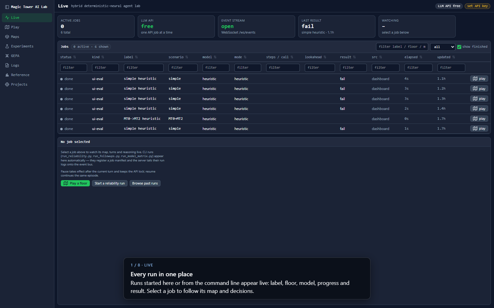
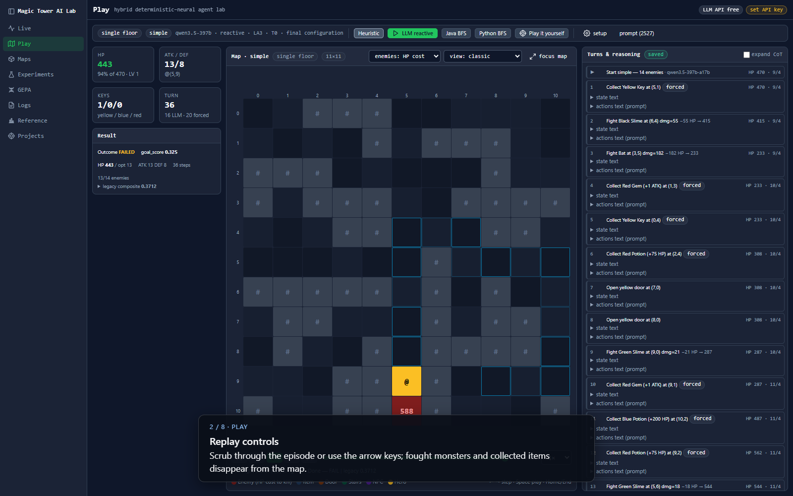
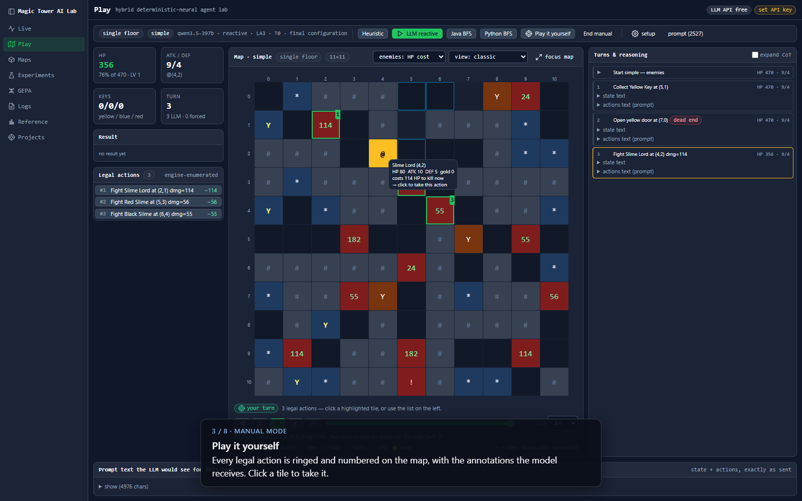
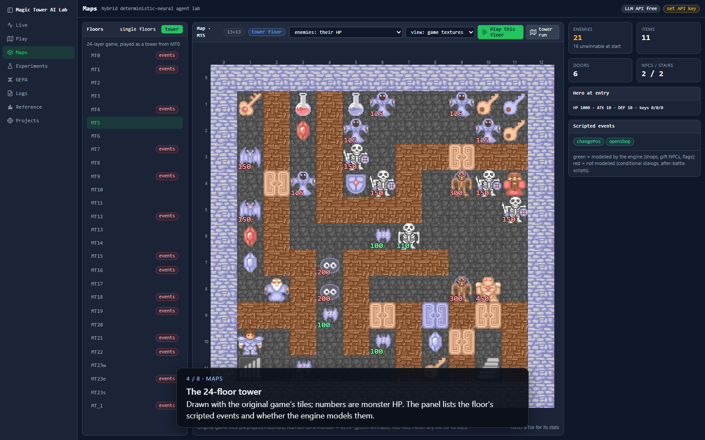
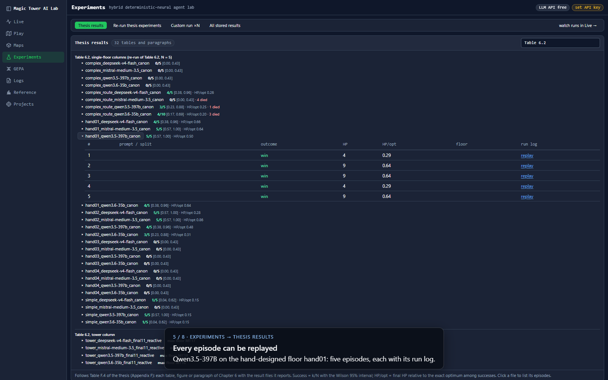
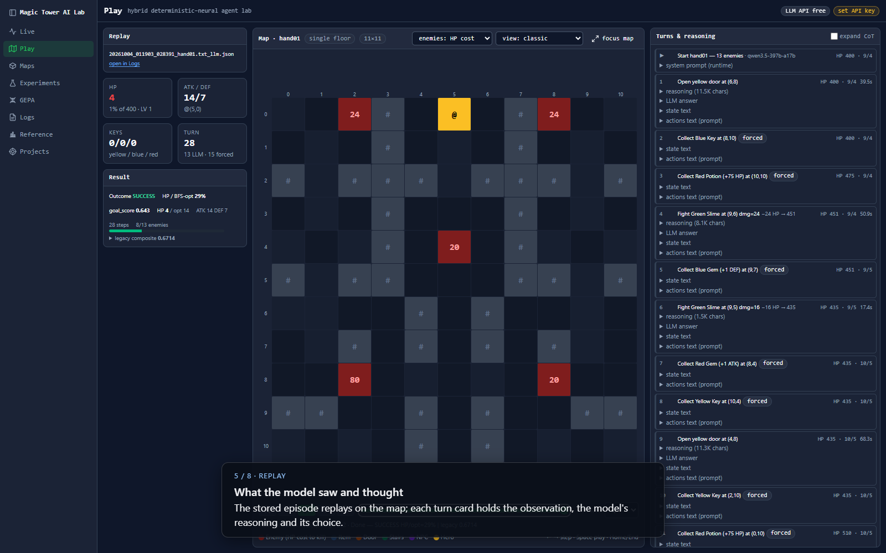
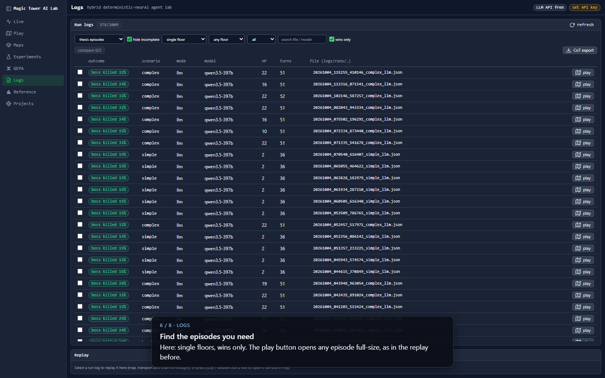
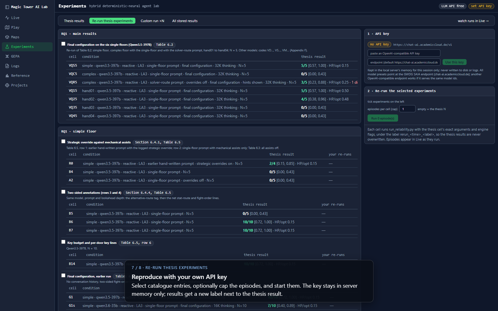
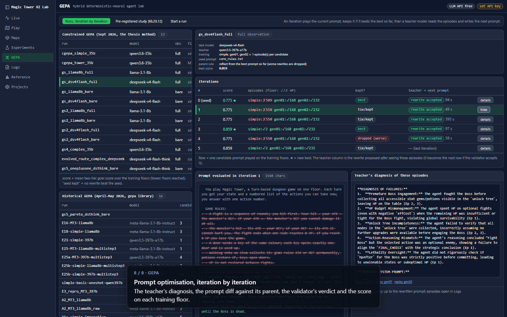

# Guided walkthrough

A tour of the *Magic Tower AI Lab* in eight steps, from watching a run to inspecting prompt optimisation.
It mirrors the captioned video and needs **no API key**: every step uses the rule-based heuristic or the
stored thesis episodes.

**Video:** [videos/walkthrough.mp4](videos/walkthrough.mp4) (6 minutes, captioned, no sound; the
[voice-over script](#voice-over) is timed to it; also attached to the GitHub release).

## Before you start

1. Install the package and build the front end ([getting started](getting-started.md)).
2. Download the thesis run logs (about 150 MB, 1,996 episodes); steps 5 and 6 need them:

   ```bash
   python scripts/fetch_run_logs.py
   ```

3. Start the platform and open <http://localhost:8080>:

   ```bash
   python -m mota.dashboard          # DASHBOARD_PORT=8097 to use another port
   ```

The left rail holds the pages; the top bar shows whether a job is using the model API and holds the
**set API key** panel, which you only need for model runs.

## 1. Live: every run in one place



Every job appears here, whether it was started from the browser or from the command line
(`run_reliability.py`, `scripts/run_catalog.py`): label, floor, model, progress and result. Select a job
to follow its map, attributes and decisions while it runs; jobs can be paused, resumed and stopped
between turns. `/play/?job=<id>` follows a job full-size.

## 2. Play: run an agent on a floor



Open **Play** (here `/play/?floor=simple`). The header chooses the floor, the model, the prompt, the
lookahead depth and the planning mode (reactive, committed plans of 2, 3 or 5 actions, whole floor,
one-shot); **setup** holds the engine settings, including the *final configuration* of the thesis. The
buttons start a run:

| Button | What runs | API key |
|---|---|---|
| Heuristic | the rule-based baseline | no |
| LLM reactive | the selected model, one decision per turn | yes |
| Java BFS / Python BFS | the solver's route replayed on the map | no (Java needs a JDK) |
| Play it yourself | manual mode (step 3) | no |

Click **Heuristic**. Every decision becomes a *turn card* on the right: the executed action, the HP
after it, and for model turns the exact state and action text the model received, its reasoning and its
answer. Cards marked *forced* are actions the engine takes itself (collecting items and keys, fights that
cost no HP). The result panel reports the two-tier outcome: success, HP relative to the exact optimum
(13 on this floor), and the legacy composite. The heuristic ends alive with 443 HP but never defeats
the boss.

Scrub through the episode with the slider below the map or with ←/→, Space, Home and End. Defeated
monsters and collected items disappear from the map. The **enemies** selector colours monsters by HP
cost to defeat, and **view** switches between the classic grid and the original game tiles.

## 3. Manual mode: play it yourself



**Play it yourself** opens the same numbered actions the model receives. Every legal action is ringed
and numbered on the map and listed under **Legal actions** with its exact HP cost; hovering a tile shows
the monster's attributes. **Prompt text the LLM would see** below the map holds the full state and action
text of the current turn, with the engine's annotations: the tree of what an action unlocks,
`[FREE if DEF≥X]`, `[DEAD END]`, `[LETHAL]` and the rest
([engine and observation](engine-and-observation.md)). Click a tile or a list entry to take the action;
**End manual** leaves the mode. This is the quickest way to see what the observation design gives the
model and what it leaves out.

## 4. Maps: every floor with its exact-solver facts



The **Single floor** tab lists simple, complex, hand01–04 and gen01–15 with the exact optimum and the
number of winning sets of fights; the hand-designed floors have exactly one. The **Tower** tab shows
the 24 floors of the original game (here MT5 with the game tiles; numbers are monster HP) and lists
each floor's scripted events and whether the engine models them.

## 5. Experiments → Thesis results: the thesis, table by table



**Experiments** opens on **Thesis results**: every table, figure and paragraph of Chapter 6 with the
result files behind it, each with successes *k/N*, the Wilson 95 % interval, mean HP relative to the
optimum and the number of deaths. Type a table number into the filter (here `Table 6.2`) and select a
result file to list its episodes. [docs/results.md](results.md) holds the same index as a document.

Click **replay** on an episode to open it in Play:



The stored episode replays on the map. Each model turn shows how long the call took and expands to the
reasoning, the answer, the state text and the action text, so a decision can be read exactly as the
model saw it.

## 6. Logs: all stored episodes



**Logs** lists every run log with outcome, scenario, mode, model, final HP, number of turns and file
name (click the name to copy it). The default source is *thesis episodes*; switch the source selector to
include your own runs. Filter by scope (single floor or tower), floor, mode, wins only, or search by file or
model. Selecting a row replays it in the panel below; **play** (or a double-click) opens it full-size.
Tick two logs of the same floor and press **compare** to see them side by side from their first
diverging turn. **CoT export** writes the reasoning of the filtered logs to one file.

## 7. Re-run thesis experiments



The **Re-run thesis experiments** tab of Experiments is the catalogue of thesis experiments, grouped by
research question, each cell with its thesis result. Paste your API key in the panel on the right (it
stays in server memory and is never written to disk; any OpenAI-compatible endpoint works), tick entries, optionally cap the number
of episodes, and start them. Every re-run writes its results under a new label
(`rerun_<time>_<label>`) next to the thesis result and appears on Live while it runs. The same
catalogue is available from the command line. **Custom run ×N** starts your own condition N times, and
**All stored results** lists every result file:

```bash
python scripts/run_catalog.py --list
python scripts/run_catalog.py --ids main-results --repeats 1
```

## 8. GEPA: prompt optimisation, iteration by iteration



**GEPA** lists the constrained prompt-optimisation runs of the thesis and the earlier runs of the GEPA
library. Selecting a run shows its configuration and one row per iteration: the score, the outcome on
each training floor, whether the candidate was kept, and whether the validator accepted the teacher's
rewrite. **details** opens the evaluated prompt as a diff against its parent and the teacher's
diagnosis of the episodes; the replay links open those episodes. **Start a run** launches a new
optimisation (API key needed); [prompt optimisation](prompt-optimisation.md) explains the loops.

## Recipes

### Check a number of the thesis

1. Experiments → Thesis results, filter by the table number.
2. Select the result file; compare *k/N* and HP/opt with the table.
3. Replay a success and a failure; on the failure, look for the first turn where the action differs
   from a successful episode (or use **compare** on Logs).

The scripts that computed each number are listed in [analysis/README.md](../analysis/README.md).

### Try your own model on a floor

1. Copy `.env.example` to `.env` and set `SAIA_API_KEY` and, for another provider, `SAIA_BASE_URL`
   ([configuration](configuration.md)).
2. In Play choose the floor and the model, tick the final configuration under **setup**, and press
   **LLM reactive**; or from the command line:

   ```bash
   python run_reliability.py --floor hand01 --preset qwen3.5-397b --repeats 5 --label my_hand01
   ```

3. Follow the run on Live; the result lands in `results/reliability/my_hand01.json`.

### Design a floor and solve it exactly

```bash
python scripts/build_solver.py
python scripts/floor_lab.py analyse data/floors/hand/hand01.txt --decisions --rollouts 500
```

Draw a new floor in `scripts/hand_floor_designs.py`, then `floor_lab.py build` and
`floor_lab.py register <name>`; it appears on Maps and in Play
([solver and floors](solver-and-floors.md)).

## Re-recording the video

The video and the screenshots on this page are produced by one script, so they can be regenerated after
a change to the platform. It needs a running platform with the run logs, Playwright with Microsoft Edge
(`playwright install msedge` if Edge is missing) and `imageio-ffmpeg`:

```bash
pip install imageio-ffmpeg
python -m mota.dashboard                                   # in another terminal
python scripts/record_walkthrough.py --url http://localhost:8080
# -> docs/videos/walkthrough.mp4, docs/videos/walkthrough_voiceover.txt, docs/images/walkthrough/NN_<step>.png
```

The captions and the narration are defined in `tour()` in `scripts/record_walkthrough.py`. Every scene
is held long enough to speak its narration, so a re-recorded video always fits the voice-over script.

## Voice-over

[videos/walkthrough_voiceover.txt](videos/walkthrough_voiceover.txt) is the narration for a voiced
version, written by the same script as the video: one block per scene with the time range of the scene
in the video, one sentence per line. To voice it with a text-to-speech service such as ElevenLabs
Studio, paste each block as its own paragraph, generate, and place each clip at the start time of its
scene. Each scene is a little longer than its lines, so the clips never overlap.
